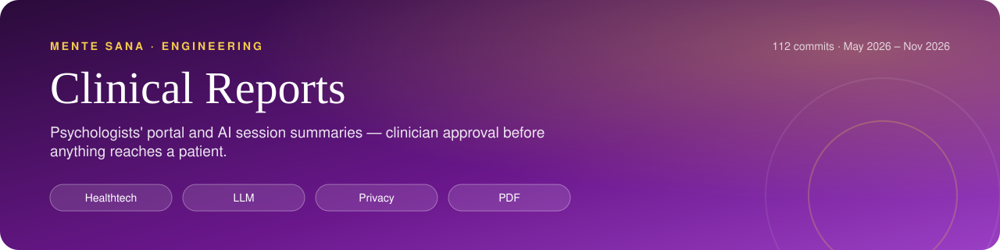
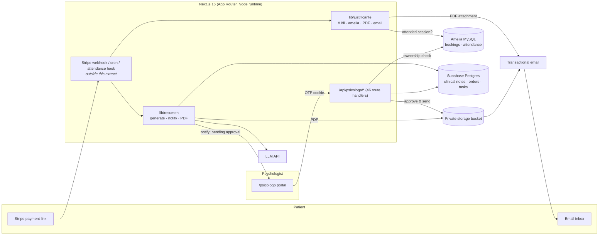

    

<h1 align="center">Clinical Reports &amp; Psychologist Portal</h1>

Extracted from the private Mente Sana production monorepo with its real commit history: <b>113 commits, May 2026 – Nov 2026</b>. Secrets and personal data were removed before publishing.

<!-- /header -->

**The clinical back office of an online psychology clinic: a portal where licensed psychologists keep clinical histories and run their caseload, plus two paid patient documents (an LLM-drafted session summary and an attendance certificate) that are generated automatically and never sent without a human check.**

Built for [Mente Sana Psicología](https://mentesanapsicologia.com), a Spanish online therapy clinic with 150+ psychologists and 8,000+ patients. This repo is an extract of the production monorepo, with its real git history (111 commits, May–Oct 2026) kept intact.

---

## At a glance

<table>
  <tr>
    <td align="center" width="25%"><b>Licensed psychologists</b> Users</td>
    <td align="center" width="25%"><b>LLM draft + clinical-risk alert</b> AI</td>
    <td align="center" width="25%"><b>Human approval, signed URLs, 7-day lock</b> Guardrail</td>
    <td align="center" width="25%"><b>Session reports &amp; attendance certificates</b> Outputs</td>
  </tr>
</table>

## The problem

- **Clinical notes lived nowhere useful.** Bookings ran on Amelia (a WordPress booking plugin with a MySQL database). Psychologists had no shared place to write session notes, see a patient's history, or pick up where a colleague left off when a patient changed therapist.
- **Paid documents had no fulfilment.** Patients could pay for a *session summary* or an *attendance certificate* through a payment link, but nobody produced or sent the document. Patients complained, sometimes several times about one order.
- **Health data raised the stakes.** Under GDPR, mental-health data is a special category (art. 9). An LLM writing patient-facing text from clinical notes must not leak supervision comments or raw diagnostic hypotheses. It also must not skip over risk signals such as suicidal ideation.

## What I built

### 1. Psychologists' portal (`/psicologo`)
- **Passwordless login.** Sign-in uses an emailed one-time code that expires after 20 minutes and is locked after 5 wrong attempts. The session lives in a signed cookie. If the email fails to send, the login says so instead of showing "code sent".
- **Clinical history per appointment.** Each appointment has a structured note: highlights, how the session went, patient state, intervention, next steps, homework and red flags. The note autosaves drafts and supports rich text. Diagnostic first sessions get a separate 10-field *Initial Clinical History* (reason for consultation, anamnesis, diagnostic impression, intervention plan…).
- **Patients and appointments.** The patient list is paginated on the server. Detail pages show the patient's package and bundle balances, counted only for the share assigned to that psychologist. Session history is shown as a timeline, and appointments can be filtered by type.
- **Continuity of care.** When a patient has moved between therapists, the patient page shows earlier psychologists' notes in a read-only banner.
- **Patient tasks.** Psychologists can assign homework after a session, with attachments and a two-way message thread, and send it to the patient by email.
- **Supervisor mode.** The two lead psychologists can view the portal as any psychologist. They are flagged as `is_supervisor` and their `original_email` is kept, so the system always knows a lead is acting, not the psychologist.
- **Other tools in the portal:**
  - a private assistant chat that searches the psychologist's own clinical notes through vector embeddings (Voyage) in Postgres;
  - read-only views of the intake test reports patients filled in before booking;
  - real-time alerts for on-demand calls, with payment-link buttons on those appointments only;
  - leader announcements, complaints to the leads, and psychologist-written SEO blog posts.

### 2. Session summary product (`src/lib/resumen`)
A paid, patient-facing PDF summary of the latest session:
1. **Find the patient.** Match the payment to the patient in Amelia, by exact email first and then by name.
2. **Collect the source material.** Take the last clinical note with real content (over 120 characters) and the 20-session history. If a session transcript summary exists within ±3 h of the session, add it too.
3. **Draft with the LLM.** An LLM (Claude) writes structured JSON under strict rules:
   - patient-facing content only, with no supervision or business remarks;
   - no invented facts;
   - no diagnoses;
   - sensitive topics reframed with dignity;
   - a separate `alert` field for clinical risk (self-harm, abuse, crisis), which reaches the psychologist but never appears in the patient's document.
4. **Render and store.** `@react-pdf/renderer` renders a branded PDF with a process timeline and focus bars. The PDF is uploaded to a **private** storage bucket.
5. **Notify the psychologist.** She gets a panel notification and an email. The leads are copied when the order is flagged for review. A reminder goes out every 24 h until it is approved.
6. **Approve and send.** One-click *Approve & send* checks ownership, claims the order so it cannot be sent twice, and emails the PDF from a 5-minute signed URL. It records who approved it.

### 3. Attendance certificate (`src/lib/justificante`)
A paid PDF certificate that a session took place, fulfilled from three entry points:
- **Stripe webhook:** an idempotent upsert keyed on the checkout session.
- **Attendance hook:** when support marks a patient as attended, that patient's pending certificates go out.
- **Cron:** retries for up to 60 days, capped at 50 attempts per order.

If the patient pays *before* the session, the order stays `pending` and a high-priority task is opened for support. That task closes automatically once the certificate is sent.

## Architecture

## Key decisions & trade-offs

| Decision | Why | Cost |
|---|---|---|
| **Nothing is sent to a patient automatically.** The cron generates the summary, but only the psychologist's *Approve & send* sends it. | LLM output about mental health needs clinical sign-off. The original commit says so directly: "Nada se auto-envia: siempre pasa por la psicologa" ("Nothing is auto-sent: it always goes through the psychologist"). | Delivery waits on a human. Shipping this alone caused a 3-day stall, which is why the notify + 24 h reminder loop was added later. |
| **A separate `alert` channel for clinical risk.** The model flags risk for the psychologist, and the patient's document stays calm. | Risk must reach a clinician, while an alarming PDF in a patient's inbox could do harm. Flagged orders also notify the clinical leads. | The model may miss a risk. The flag adds a safety net; the psychologist's review is still the main check. |
| **Ownership is checked against the booking system on every request.** Before returning or writing data, each clinical endpoint confirms in Amelia that the appointment or patient belongs to the logged-in psychologist. | Without that check, changing an ID in the URL would expose another patient's health data. The code comments call this out explicitly. | One extra MySQL query per request. |
| **Minimal personal data in the portal.** Patient list and detail endpoints return names only, never phone numbers or emails. | Data minimisation (GDPR art. 5): psychologists don't need contact details to treat. Patient contact goes through the clinic. | Psychologists must use clinic channels (task email, payment-link email) instead of contacting patients directly. |
| **Clinical PDFs live in a private bucket.** Access is only through short-lived signed URLs: 5 minutes to send, 1 hour to preview. | Special-category data should never sit at a public URL. | Previews expire and are re-signed on each list load. |
| **Clinical notes lock after 7 days.** Editing an older note returns `423 Locked` until a lead approves a request, and the request must include a reason. | Keeps clinical records written close to the session and leaves an audit trail for late edits. | Friction for late note-takers, by design. |
| **One source of truth for attendance.** The booking system decides attendance; the old "psychologist marks attendance" endpoint now returns `403`. The portal derives attendance from the booking status, and history and tasks stay locked while a patient is marked no-show. | Psychologists' marks and support's records disagreed. Attendance also gates billing, the certificate and bundle counts. | A week-long transition (Jun 2026) still left attendance pills in the note form, which synced back to Amelia. |
| **Every send is idempotent.** Each send first moves the order to a `sending` state with a conditional update; if that claim fails, nothing is sent. The certificate upsert is keyed on the Stripe session ID. | Webhooks, crons and manual hooks can all fire for the same order, and a patient must never get a document twice. | A crash mid-send can leave an order in `sending`. The summary route rolls it back on error. |
| **Strict matching for certificates.** The certificate only covers an *attended* session from the last 21 days and no more than 7 days before payment. Contacts are matched by email or by the last 9 digits of the phone number. | Prevents certifying the wrong session, or a session that never happened. | Some legitimate edge cases fall back to a support task. |
| **The panel requires the paired browser extension.** On desktop, the panel layout redirects to an install page until the psychologist pairs it; mobile is exempt. The extension, which is not in this repo, captures Meet captions; UI copy states these are anonymised in the browser before upload. Transcript summaries go through a psychologist review/approve step. | Session summaries need source material, and the gate is "paired once" rather than a live heartbeat. | The history shows the gate was tuned several times (12 h heartbeat → paired-once) after false lockouts. |
| **PDFs are rendered on the server with `@react-pdf` and no disk reads.** | Keeps serverless bundles small and deploys predictable. | The logo is drawn with text and simple shapes instead of an image asset. |

## Code tour

| Path | What to look at |
|---|---|
| `src/lib/resumen/generate.ts` | Patient matching, building the session context, LLM prompt with clinical guardrails, defensive parsing of the model's JSON (e.g. accepting 0–100 instead of 0–1), private upload and signed URLs |
| `src/lib/resumen/notify.ts` | Approval notifications and reminders, with escalation to the leads |
| `src/lib/resumen/resumen-pdf.ts` | The patient-facing PDF: timeline, focus bars, checklist, seal |
| `src/app/api/psicologa/resumenes/approve/route.ts` | Ownership check → status claim → signed-URL fetch → email → audit (`approved_by`) |
| `src/lib/justificante/fulfil.ts` | Three entry points, atomic claim, support-task fallback, retry cron |
| `src/lib/justificante/amelia.ts` | SQL that finds the attended session (email or phone match, time window) |
| `src/app/api/psicologa/appointments/[id]/route.ts` | Clinical note CRUD: ownership check, 7-day lock, field length limits, booking sync, non-blocking embedding |
| `src/app/api/psicologa/patients/[id]/route.ts` | Patient detail with contact details left out, plus read-only notes from earlier psychologists |
| `src/app/api/psicologa/hc-unlock/route.ts` | Request to unlock an old note, with a required reason, sent to the leads |
| `src/app/api/psicologa/auth/*` | Email one-time-code login: expiry, attempt cap, supervisor detection |
| `src/app/api/psicologa/encuadre-report/route.ts` | Pattern for showing pre-booking test reports to the assigned psychologist only |
| `src/app/psicologo/(panel)/citas/[id]/page.tsx` | Appointment workspace: attendance step, locked states, autosave, unlock request UI |

Size: 46 route handlers under `/api/psicologa` and 19 pages under `/psicologo`, about 9.8k lines of TypeScript/TSX.

## Testing

There are **no automated tests in this extract.** These modules were checked by hand against production data. Some safeguards also show up as defensive code, for example rolling back a failed send and clamping the model's numeric output. Treat this as a known gap. If I were extending it, I would start with tests for the claim/idempotency paths and the certificate session-matching window.

## Stack

Next.js 16 (App Router, route handlers, Node runtime) · React · TypeScript · Supabase (Postgres, Storage, pgvector-style RAG) · Amelia booking DB (MySQL) · Stripe (webhooks) · `@react-pdf/renderer` · Anthropic Claude API (summary drafting, assistant) · Voyage embeddings · Brevo transactional email · Vercel (serverless + cron)

## About this repo

- **Not runnable on its own.** This is a slice of a private monorepo. Shared helpers (`@/lib/amelia-db`, `@/lib/emails`, `@/lib/psicologa-auth`, `@/lib/panel-tasks`…), the Stripe webhook, the crons and the database migrations are not included.
- **History is real.** The 111 commits come from the original repo, filtered down to these paths. Commit messages are in Spanish, as written at the time.
- **Redacted.** Secrets and personal data have been removed or replaced with placeholders (e.g. `cto@example.com`).
- **Author:** Alejandro Álvarez, CTO at Mente Sana. I designed and built these modules end to end: product scoping, data model, backend, UI, PDF design and rollout with the clinical team.
